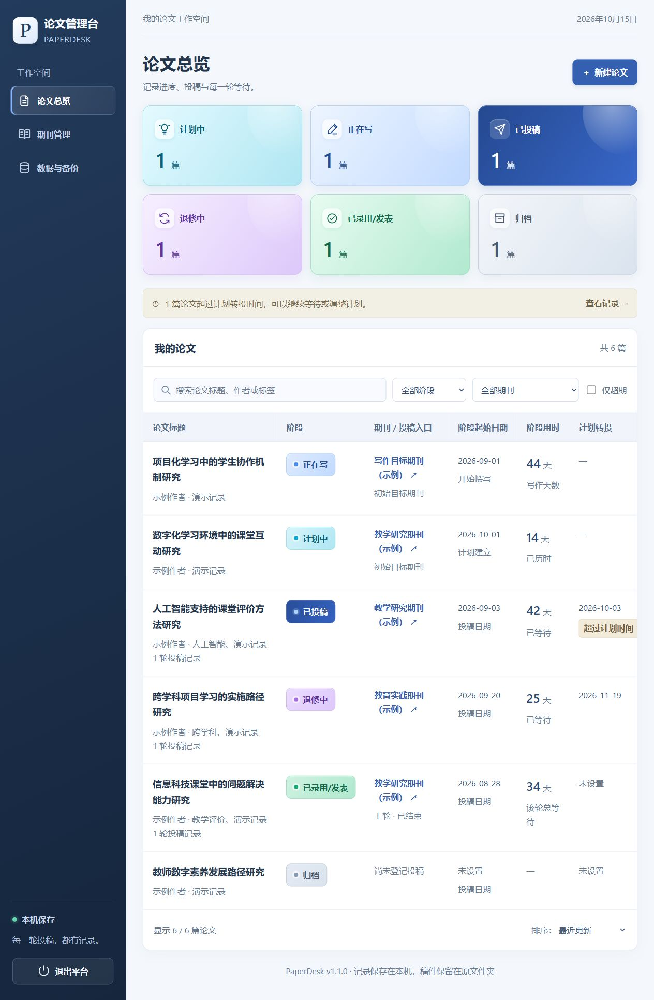

# PaperDesk · 论文管理台

一个在 Windows 本机运行的论文投稿管理工具。浏览器提供界面，Python 和 SQLite 自动保存记录，无需购买服务器或安装第三方依赖。



## 开始使用

1. 安装 **Python 3.12**，保留 Python Launcher 和 Tk 组件。
2. 下载 [最新版本](https://github.com/chuiyukong/paperdesk/releases/latest) 的 ZIP，解压到一个固定文件夹。
3. 双击 **启动论文管理平台.cmd**，浏览器自动打开平台。

默认优先使用 `http://127.0.0.1:8766/`。端口被占用时自动选择后续可用端口；重复启动复用已有服务。访问网址只会打开页面，启动程序需要双击入口。

## 功能

- 六种阶段：计划中、正在写、已投稿、退修中、已录用/发表、归档。
- 计划中、正在写可记录初始目标期刊，独立于实际投稿期刊和转投候选。
- 分别记录计划建立日期、开始撰写日期，并显示对应阶段的天数。
- 每轮投稿分别记录期刊、日期、稿件编号、反馈、结果和等待天数。
- 按等待天数或具体日期安排转投，保存有序候选期刊；只显示超期提示。
- 管理期刊投稿入口，关联并打开本地稿件及文件夹。
- 标题、作者、标签搜索，阶段与期刊筛选，按日期或等待天数排序。
- 本机自动快照、完整 JSON 导出与恢复。
- 海军蓝白界面，六种状态采用大面积渐变色块、独立图标与清晰标签。
- 全界面文字最小 16px，日期使用中文年月日，提供明确的退出按钮。

界面截图使用独立演示记录。首次运行从空白开始，不会扫描已有稿件。

## 保存与升级

数据位于 Windows 当前用户的 `%LOCALAPPDATA%\PaperDesk\`，与程序源码分开。更新时先退出平台，再替换程序文件并重新启动；`v1.1.0` 首次启动前备份并升级第一版数据库，也支持恢复第一版 JSON 和本机快照。旧记录未填写的阶段日期和初始目标期刊保持为空，可自行补填。

自动备份保留最近 30 天。可在“数据与备份”中定期导出完整记录到其他位置。备份只保存稿件路径，不包含稿件正文。

公开仓库包含程序、说明、测试与演示截图。真实论文记录、稿件、数据库和运行日志不纳入版本控制。

详细操作见 [使用说明](使用说明.md)，版本变化见 [更新记录](CHANGELOG.md)，验证结果见 [功能验证](功能验证.md)。

## 版本

- [v1.0.0](https://github.com/chuiyukong/paperdesk/releases/tag/v1.0.0)：最初交付的第一版，完整保留。
- [v1.1.0](https://github.com/chuiyukong/paperdesk/releases/tag/v1.1.0)：海军蓝白主题、六色状态模块、默认端口 8766、阶段计时、初始目标期刊、中文日期及字号和退出按钮改进。

当前版本写在 `VERSION` 文件中，并显示在平台页脚。

## 开发与验证

Python 3.12 标准库即可运行：

```text
py -3.12 -m unittest -v test_paperdesk
py -3.12 paperdesk.py --no-browser
```

也可通过 `--data-dir` 指定独立测试数据目录，通过 `--port` 指定测试端口。GitHub Actions 会在 Windows 上执行自动测试。
